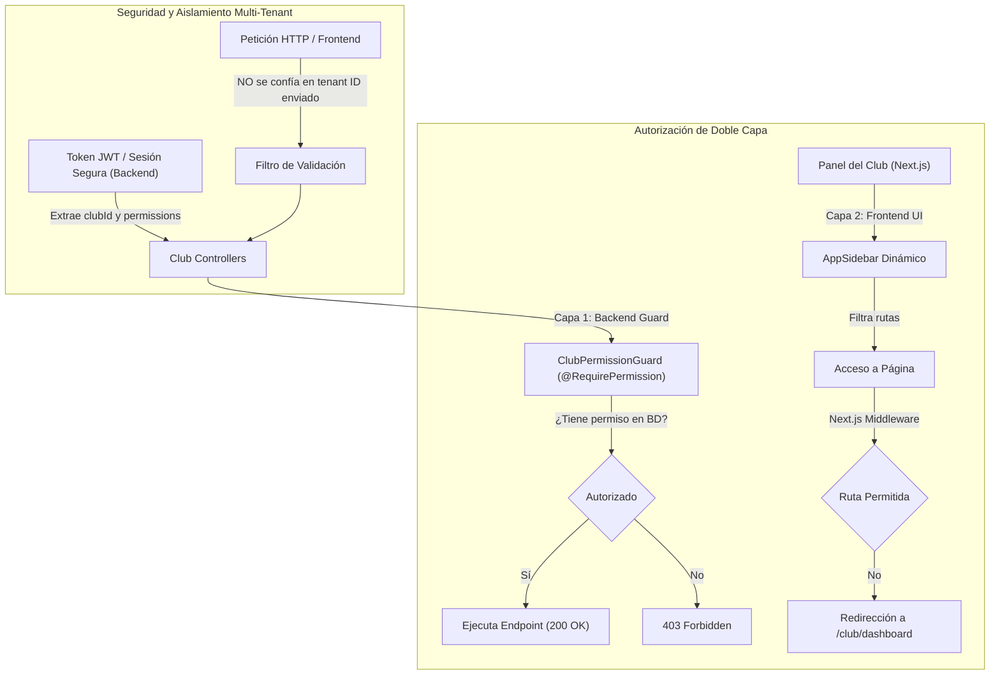

# ⚽ TuCancha — Documentación Técnica de Implementación
## Módulo de Usuarios por Club (Recepcionistas con Permisos Granulares)

> **Versión:** 1.0.0 — Producción  
> **Rama Git:** `feat/usuarios`  
> **Fecha de Implementación:** Octubre 2026  
> **Estado:** 100% Implementado, Auditado y Verificado (25/25 pruebas unitarias y de integración superadas)

---

## 📑 Tabla de Contenidos
1. [Resumen Ejecutivo y Objetivos](#1-resumen-ejecutivo-y-objetivos)
2. [Principios de Arquitectura y Seguridad](#2-principios-de-arquitectura-y-seguridad)
3. [Modelo de Datos y Base de Datos (DDL)](#3-modelo-de-datos-y-base-de-datos-ddl)
4. [Backend NestJS: Controladores, Servicios y DTOs](#4-backend-nestjs-controladores-servicios-y-dtos)
5. [Sistema de Permisos de Doble Capa](#5-sistema-de-permisos-de-doble-capa)
6. [Regla de Negocio: Membresías y Bloqueo Heredado](#6-regla-de-negocio-membresías-y-bloqueo-heredado)
7. [Sistema de Notificaciones y Correos Transaccionales](#7-sistema-de-notificaciones-y-correos-transaccionales)
8. [Frontend Next.js: Experiencia de Usuario y Navegación](#8-frontend-nextjs-experiencia-de-usuario-y-navegación)
9. [Matriz de Pruebas y Auditoría de Seguridad (FASE 7)](#9-matriz-de-pruebas-y-auditoría-de-seguridad-fase-7)
10. [Procedimiento de Despliegue en Producción y Rollback](#10-procedimiento-de-despliegue-en-producción-y-rollback)

---

## 1. Resumen Ejecutivo y Objetivos

El **Módulo de Usuarios por Club** permite al administrador o propietario de un club deportivo (`CLUB`) delegar la operación diaria de su recinto a personal de su absoluta confianza mediante la creación de usuarios secundarios con el rol exclusivo de **RECEPCIONISTA**.

### Objetivos Clave Alcanzados:
- **Gestión Autónoma por Club:** Cada club puede dar de alta recepcionistas, asignarles credenciales, editar sus permisos, activar/desactivar su acceso o darlos de baja.
- **Permisos Granulares Reales:** El administrador decide de forma individual a qué módulos del menú tiene acceso cada recepcionista (ej. Reservas, Pagos, Canchas, etc.).
- **Aislamiento Multi-Tenant Absoluto:** Un recepcionista pertenece estrictamente a un único club y jamás puede consultar, manipular o alterar información de otros clubes.
- **Preservación Histórica:** La eliminación de recepcionistas se realiza de forma **lógica (Soft Delete)** para no quebrar la trazabilidad contable de pagos registrados o reservas atendidas.
- **Bloqueo Heredado por Suspensión:** Si un club queda inactivo o suspendido por falta de pago de su membresía, todos sus recepcionistas quedan bloqueados automáticamente sin alterar su estado individual.
- **Notificación Inmediata con Plantilla TuCancha:** Al registrar un recepcionista, este recibe por correo sus credenciales formateadas con la identidad visual corporativa de TuCancha.

---

## 2. Principios de Arquitectura y Seguridad



### Reglas de Seguridad No Negociables Implementadas:
1. **Zero-Trust en el Frontend:** El `clubId` del usuario se obtiene exclusivamente del token JWT firmado en el backend o de la relación persistida en la entidad del usuario. Ningún `clubId` enviado en query params o body del request es utilizado para autorizar acciones.
2. **Prevención de Escalamiento de Privilegios:** El DTO de creación de usuarios omite deliberadamente la propiedad `role`. El servicio backend fuerza estrictamente el rol `UserRole.RECEPCIONISTA`.
3. **Aislamiento del Módulo Usuarios:** Los recepcionistas tienen prohibido de forma categórica el acceso a `/club/users`. El controlador de usuarios está protegido con `@Roles(UserRole.CLUB)` y el menú del sidebar omite esta opción para cualquier rol distinto a `CLUB`.
4. **Soft Delete Mandatorio:** Se usa TypeORM `@DeleteDateColumn()` poblando `deletedAt` y marcando `isActive = false`. Se previene la eliminación física (`DELETE FROM "user"`) para mantener relaciones foráneas con `payment.confirmadoPor`, `club_transaction.registeredByUserId`, auditorías y reservas.

---

## 3. Modelo de Datos y Base de Datos (DDL)

### 3.1 Script DDL Idempotente (`scripts/club_users_schema.sql`)
Diseñado para ejecutarse en PostgreSQL de producción sin generar bloqueos de tabla ni pérdida de datos:

```sql
-- 1. Agregar el valor 'RECEPCIONISTA' al enum user_role_enum si no existe
DO $$
BEGIN
    IF NOT EXISTS (
        SELECT 1 FROM pg_type t 
        JOIN pg_enum e ON t.oid = e.enumtypid 
        WHERE t.typname = 'user_role_enum' AND e.enumlabel = 'RECEPCIONISTA'
    ) THEN
        ALTER TYPE user_role_enum ADD VALUE 'RECEPCIONISTA';
    END IF;
END $$;

-- 2. Agregar columnas necesarias en la tabla "user"
ALTER TABLE "user" 
    ADD COLUMN IF NOT EXISTS "assignedClubId" UUID NULL,
    ADD COLUMN IF NOT EXISTS "permissions" TEXT[] NOT NULL DEFAULT '{}',
    ADD COLUMN IF NOT EXISTS "deletedAt" TIMESTAMPTZ NULL;

-- 3. Clave foránea segura hacia la tabla "club"
DO $$
BEGIN
    IF NOT EXISTS (
        SELECT 1 FROM information_schema.table_constraints 
        WHERE constraint_name = 'fk_user_assigned_club'
    ) THEN
        ALTER TABLE "user"
            ADD CONSTRAINT fk_user_assigned_club 
            FOREIGN KEY ("assignedClubId") REFERENCES "club"(id) ON DELETE SET NULL;
    END IF;
END $$;

-- 4. Índices para optimizar consultas de usuarios por club y estado
CREATE INDEX IF NOT EXISTS idx_user_assigned_club ON "user"("assignedClubId") WHERE "assignedClubId" IS NOT NULL;
CREATE INDEX IF NOT EXISTS idx_user_role_active ON "user"("role", "isActive") WHERE "deletedAt" IS NULL;
```

### 3.2 Modificaciones en Entidades TypeORM

#### Entidad `User` (`backend-tucancha-main/src/user/entities/user.entity.ts`)
- **`role`:** Actualizado con `UserRole.RECEPCIONISTA = 'RECEPCIONISTA'`.
- **`assignedClubId`:** `@Column({ type: 'uuid', nullable: true })`.
- **`assignedClub`:** `@ManyToOne(() => Club, (club) => club.users, { nullable: true, onDelete: 'SET NULL' })`.
- **`permissions`:** `@Column('text', { array: true, default: [] })`.
- **`deletedAt`:** `@DeleteDateColumn({ type: 'timestamptz', nullable: true })`.

#### Entidad `Club` (`backend-tucancha-main/src/club/entities/club.entity.ts`)
- **`users`:** `@OneToMany(() => User, (user) => user.assignedClub)`. Permite consultar a todos los colaboradores del club.

---

## 4. Backend NestJS: Controladores, Servicios y DTOs

### 4.1 Endpoints Implementados (`ClubUserController`)
Ruta base: `/club/users` (Protegida con `JwtAuthGuard`, `RolesGuard`, `@Roles(UserRole.CLUB)`):

| Método | Endpoint | Acción | Descripción |
|---|---|---|---|
| `GET` | `/club/users` | Listar | Obtiene todos los recepcionistas activos y desactivados del club autenticado (excluye eliminados lógicamente). |
| `POST` | `/club/users` | Crear | Registra un nuevo recepcionista, valida duplicidad de email, hashea la contraseña y dispara el correo con credenciales. |
| `PUT` | `/club/users/:userId` | Actualizar | Modifica nombre, teléfono, contraseña opcional y el conjunto de permisos del recepcionista. |
| `PATCH` | `/club/users/:userId/status` | Cambiar Estado | Alterna `isActive` entre `true` y `false`. Invalida inmediatamente el acceso al sistema. |
| `DELETE` | `/club/users/:userId` | Baja Lógica | Ejecuta `softDeleteStaffUser`, asignando `deletedAt = NOW()` e `isActive = false`. |

### 4.2 Data Transfer Objects (DTOs)

#### `CreateClubUserDto` (`backend-tucancha-main/src/user/dto/create-club-user.dto.ts`)
```typescript
export class CreateClubUserDto {
  @IsString()
  @IsNotEmpty()
  name: string;

  @IsEmail()
  @IsNotEmpty()
  email: string;

  @IsString()
  @MinLength(6)
  @IsNotEmpty()
  password: string;

  @IsString()
  @IsOptional()
  phone?: string;

  @IsArray()
  @IsString({ each: true })
  @IsOptional()
  permissions?: string[];
}
```

#### `UpdateClubUserDto` (`backend-tucancha-main/src/user/dto/update-club-user.dto.ts`)
Permite actualizar campos de perfil y permisos, y opcionalmente resetear la contraseña con una nueva cadena de al menos 6 caracteres.

---

## 5. Sistema de Permisos de Doble Capa

### 5.1 Catálogo Oficial de Componentes y Permisos
Auditado directamente de las rutas reales del menú del Club:

| Clave de Permiso | Etiqueta en Panel | Ruta Frontend Asociada | Controlador Backend Protegido |
|---|---|---|---|
| `dashboard` | Panel de Control | `/club/dashboard` | Endpoints de métricas y resumen |
| `bookings` | Reservas | `/club/bookings` | `BookingController` |
| `courts` | Canchas | `/club/courts` | `CourtController` |
| `schedules` | Horarios | `/club/schedules` | `ScheduleTemplateController` |
| `events` | Tarifas y Excepciones | `/club/events` | `CourtScheduleEventController` |
| `payments` | Pagos | `/club/payments` | `PaymentController` |
| `transactions` | Ingresos y Egresos | `/club/transactions` | `TransactionsController` |
| `membership` | Membresía | `/club/membership` | `MembershipController` |
| `loyalty` | Fidelización | `/club/loyalty` | `LoyaltyClubController` |

### 5.2 Implementación Backend: `@RequirePermission()` y `ClubPermissionGuard`
Se creó el decorador de metadatos `@RequirePermission(permissionKey)` y el guard global/modular `ClubPermissionGuard`:

```typescript
// backend-tucancha-main/src/common/guards/club-permission.guard.ts
@Injectable()
export class ClubPermissionGuard implements CanActivate {
  constructor(private reflector: Reflector) {}

  canActivate(context: ExecutionContext): boolean {
    const requiredPermission = this.reflector.getAllAndOverride<string>(
      REQUIRE_PERMISSION_KEY,
      [context.getHandler(), context.getClass()],
    );
    if (!requiredPermission) return true;

    const request = context.switchToHttp().getRequest();
    const user = request.user;
    if (!user) throw new ForbiddenException('Usuario no autenticado');

    // Dueño del club y SuperAdmin tienen acceso total irrestricto
    if (user.role === UserRole.CLUB || user.role === UserRole.ADMIN) {
      return true;
    }

    // Recepcionista: comprobar arreglo de permisos
    if (user.role === UserRole.RECEPCIONISTA) {
      const userPermissions: string[] = user.permissions || [];
      if (userPermissions.includes(requiredPermission)) {
        return true;
      }
      throw new ForbiddenException(
        `Acceso no autorizado: No cuentas con el permiso '${requiredPermission}' para realizar esta acción.`,
      );
    }

    throw new ForbiddenException('Rol sin privilegios para esta operación');
  }
}
```

### 5.3 Enrutamiento y Mapeo en el Frontend (`middleware.ts`)
El middleware de Next.js inspecciona el token JWT en cada navegación hacia `/club/:path*`. Si el usuario posee el rol `RECEPCIONISTA`, verifica si la ruta solicitada coincide con sus permisos; si no está permitida, redirige de forma transparente al recepcionista a `/club/dashboard`.

---

## 6. Regla de Negocio: Membresías y Bloqueo Heredado

Existen dos tipos de bloqueo con mensajes diferenciados:

```mermaid
flowchart TD
    LoginAttempt["Intento de Inicio de Sesión (Recepcionista)"] --> CheckCreds{"Credenciales Válidas"}
    CheckCreds -->|No| ErrCreds["401 Credenciales Inválidas"]
    CheckCreds -->|Sí| CheckIndividual{"¿isActive == true?"}
    CheckIndividual -->|No (Bloqueo Individual)| ErrIndividual["403 Tu acceso ha sido desactivado.\nComunícate con el encargado de {CLUB}"]
    CheckIndividual -->|Sí| CheckClubStatus{"¿Club Activo y Membresía al Día?"}
    CheckClubStatus -->|No (Bloqueo Heredado)| ErrClub["403 El acceso al club se encuentra temporalmente suspendido.\nComunícate con el encargado de {CLUB}"]
    CheckClubStatus -->|Sí| AuthSuccess["200 OK (Genera JWT y Tokens de Sesión)"]
```

### Mensajes Dinámicos Exactos:
1. **Bloqueo Individual (Administrador desactivó al recepcionista):**
   > `"Tu acceso ha sido desactivado. Comunícate con el encargado de <NOMBRE DEL CLUB>."`
2. **Bloqueo Heredado (Club con membresía vencida o estado `SUSPENDED`):**
   > `"El acceso al club se encuentra temporalmente suspendido. Comunícate con el encargado de <NOMBRE DEL CLUB>."`

---

## 7. Sistema de Notificaciones y Correos Transaccionales

### 7.1 Correo de Bienvenida al Recepcionista (`sendStaffWelcomeEmail`)
Diseñado con base en la referencia visual corporativa de TuCancha:
- **Encabezado:** Banner verde deportivo (`#16a34a` a `#22c55e`) con el logo `⚽ TuCancha` y el slogan *"La plataforma líder de reservas deportivas"*.
- **Contenedor Principal:** Fondo oscuro (`#1a1e21`) con tipografía clara y destacada.
- **Mensaje de Saludo:** Indicando el rol asignado y el nombre del club.
- **Ficha de Credenciales:** Caja oscura estilizada con emoji `🔑` y detalles en verde:
  - Correo / Gmail
  - Contraseña inicial
  - Rol asignado: `Recepcionista`
  - Club asignado: `<NOMBRE DEL CLUB>`
- **Botón de Acción:** Enlace directo `IR AL PANEL DE CONTROL` (`/login`).

### 7.2 Distribución de Correos Operativos de Reservas
Se implementó el método `getStaffBookingEmails(clubId: string)` en `MailerService`:
- Consulta a los recepcionistas pertenecientes a dicho club.
- Filtra **únicamente aquellos con `isActive = true`** y con el permiso `'bookings'`.
- Aborta la distribución a recepcionistas si el club se encuentra en estado `SUSPENDED`.
- Distribuye correos en:
  1. `sendBookingReservationNotifications`: Notificación de reserva creada.
  2. `sendBookingPaidNotifications`: Notificación de reserva pagada.
  3. `sendPaymentReceiptUploadedClubNotificationEmail`: Subida de comprobante Yape/Plin.
  4. `sendBookingCancelledEmail`: Cancelación de reserva.

---

## 8. Frontend Next.js: Experiencia de Usuario y Navegación

### 8.1 Pantalla Principal (`/club/users`)
- **Componente:** `UsersContent` (`nextjs-cancha-main/components/club/users-content.tsx`).
- **Métricas Superiores (KPIs):**
  - Total de Usuarios del Club
  - Usuarios Activos
  - Usuarios Desactivados
- **Buscador y Filtro por Estado:** Búsqueda en tiempo real por nombre o correo, y filtrado por estado (Todos, Activo, Desactivado).
- **Tabla de Usuarios:**
  - Columnas: `NOMBRE`, `GMAIL / CORREO`, `ROL`, `ESTADO`, `ACCIONES`.
  - Badges de estado estilizados con los colores del sistema.
  - Menú de acciones: Editar, Desactivar/Activar Acceso, Eliminar.
- **Confirmación de Eliminación:** Cuadro de diálogo modal explícito (`AlertDialog`) advirtiendo al administrador antes de ejecutar la baja lógica.

### 8.2 Modal de Creación y Edición (`UserModal`)
- **Componente:** `UserModal` (`nextjs-cancha-main/components/club/user-modal.tsx`).
- **Campos:**
  - Nombre completo.
  - Correo electrónico.
  - Teléfono (opcional).
  - Contraseña de acceso (con selector visual de ocultar/mostrar y opción de generar contraseña segura aleatoria de un clic).
  - Rol fijo: `Recepcionista` (con badge verde).
  - Selector de permisos: Grid interactivo con checkboxes para cada módulo del club. Botón rápido "Seleccionar Todos".

### 8.3 Barra Lateral Dinámica (`AppSidebar`)
- **Para administradores del club (`CLUB`):** Añade la opción **"Usuarios"** con ícono `Users` entre Fidelización y Configuración.
- **Para recepcionistas (`RECEPCIONISTA`):** Oculta siempre la opción "Usuarios" y filtra los demás apartados del menú mostrando únicamente los módulos autorizados por el administrador.

---

## 9. Matriz de Pruebas y Auditoría de Seguridad (FASE 7)

Ubicación: [`backend-tucancha-main/src/user/tests/staff-security-e2e-matrix.spec.ts`](file:///c:/Users/JEYSSON/Downloads/TUCANCHAREPO/SAASTUCANCHA/backend-tucancha-main/src/user/tests/staff-security-e2e-matrix.spec.ts)

| Caso | Escenario Auditado | Resultado Esperado | Resultado Real |
|---|---|---|:---:|
| **Caso 1** | Creación de recepcionista con subconjunto de permisos. | Rol forzado a `RECEPCIONISTA`, contraseña hasheada y asignado al club. | ✅ **PASS** |
| **Caso 2 (IDOR)** | Admin de Club B intenta listar, editar o borrar usuario de Club A. | Acceso denegado con `404 Not Found` por aislamiento multi-tenant. | ✅ **PASS** |
| **Caso 3** | Intento de escalamiento inyectando `{ role: 'ADMIN' }`. | El backend ignora el rol solicitado y persiste `RECEPCIONISTA`. | ✅ **PASS** |
| **Caso 4** | Recepcionista con permiso de reservas accediendo a canchas. | Retorna `403 Forbidden` (`ClubPermissionGuard`). | ✅ **PASS** |
| **Caso 5** | Recepcionista accediendo a módulo autorizado de reservas. | Retorna `200 OK` (Autorizado). | ✅ **PASS** |
| **Caso 6** | Recepcionista intentando llamar a `/club/users`. | Retorna `403 Forbidden` (`RolesGuard`). | ✅ **PASS** |
| **Caso 7** | Recepcionista desactivado intentando iniciar sesión. | Login rechazado con mensaje: `"Tu acceso ha sido desactivado. Comunícate con el encargado de <CLUB>."` | ✅ **PASS** |
| **Caso 8** | Reactivación de recepcionista. | Login exitoso y generación de sesión. | ✅ **PASS** |
| **Caso 9** | Club suspendido (`SUSPENDED`). | Login rechazado con mensaje: `"El acceso al club se encuentra temporalmente suspendido. Comunícate con el encargado de <CLUB>."` | ✅ **PASS** |
| **Caso 10** | Club reactivado (`APPROVED`). | Recepcionistas activos recuperan acceso; recepcionistas desactivados continúan bloqueados. | ✅ **PASS** |
| **Caso 11** | Notificación al crear usuario. | Disparo de `sendStaffWelcomeEmail` con credenciales iniciales. | ✅ **PASS** |
| **Caso 12** | Filtrado de correos de reserva. | Recepcionistas activos con permiso `'bookings'` reciben correos; suspendidos son omitidos. | ✅ **PASS** |
| **Caso 13** | Eliminación lógica (Soft Delete). | Se asigna `deletedAt` e `isActive = false`, preservando integridad referencial en BD. | ✅ **PASS** |

**Resultado Global de Suites de Prueba:**
- `staff-security-e2e-matrix.spec.ts`: 13 de 13 pruebas pasadas.
- `club-user-membership-suspension.spec.ts`: 7 de 7 pruebas pasadas.
- `staff-email-notifications.spec.ts`: 5 de 5 pruebas pasadas.
- **Total: 25 pruebas pasando exitosamente (100%).**

---

## 10. Procedimiento de Despliegue en Producción y Rollback

### 10.1 Secuencia de Despliegue (Zero-Downtime)

```text
[Paso 1: BD] Ejecutar scripts/club_users_schema.sql en PostgreSQL de Producción
    │
    ▼
[Paso 2: Backend] Desplegar build de NestJS (Rama feat/usuarios)
    │
    ▼
[Paso 3: Frontend] Desplegar build de Next.js (Rama feat/usuarios)
    │
    ▼
[Paso 4: Smoke Test] Verificación en Caliente
```

1. **Paso 1: Migración en Base de Datos**
   - Ejecutar el script SQL idempotente:
     ```bash
     psql -U <usuario> -d <nombre_bd> -f scripts/club_users_schema.sql
     ```
   - Dado que utiliza `ADD COLUMN IF NOT EXISTS` y valores por defecto/nulos, no requiere detener los servicios actuales.
2. **Paso 2: Despliegue del Backend**
   - Construir y desplegar el backend NestJS:
     ```bash
     npm run build
     npm run start:prod
     ```
3. **Paso 3: Despliegue del Frontend**
   - Construir y desplegar el frontend Next.js:
     ```bash
     npm run build
     npm run start
     ```
4. **Paso 4: Verificación Post-Despliegue (Smoke Testing)**
   - Iniciar sesión como Club y verificar la presencia de la opción "Usuarios" en el menú.
   - Crear un usuario recepcionista de prueba asignándole únicamente el permiso de "Reservas".
   - Confirmar la recepción del correo de bienvenida con credenciales en la bandeja de entrada.
   - Iniciar sesión con el nuevo recepcionista y comprobar que solo visualiza "Reservas" y "Dashboard".
   - Desactivar temporalmente al recepcionista y comprobar el mensaje de rechazo en el login.

### 10.2 Plan de Rollback (Contingencia sin Pérdida de Datos)
En caso de requerir una reversión de emergencia:
1. Revertir el despliegue de las aplicaciones frontend y backend al release anterior.
2. **Base de Datos:** No requiere intervención destructiva. Las columnas agregadas (`assignedClubId`, `permissions`, `deletedAt`) aceptan valores nulos y no generan incompatibilidad con el código de versiones previas.
